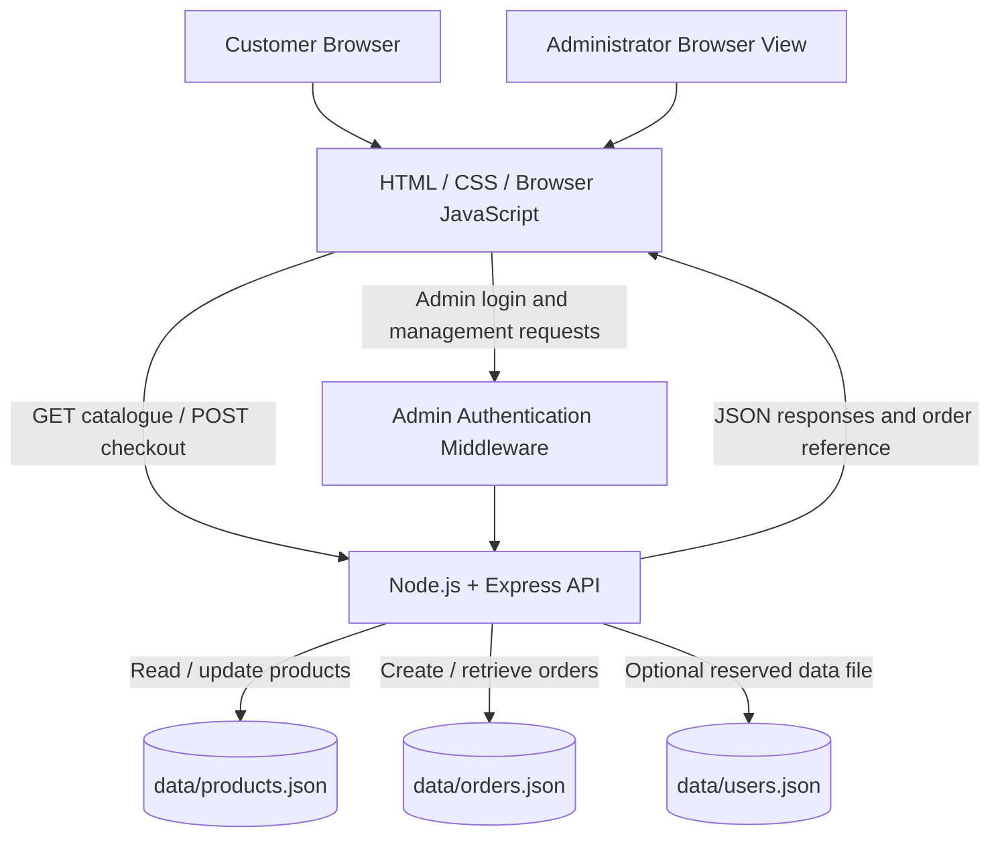

# ABH SPORTS — Built for the Win

**Course:** EF101 — Fall 2026  
**Project ID:** EF101-P18  
**Project title:** Mini E-Commerce Store  
**Product domain:** Cricket equipment  
**Storefront reference:** Public shopping patterns observed on Miandad Sports; ABH SPORTS branding and implementation are original.

> **Submission note:** Fill in the group-member names and individual contributions. The test plan is provided for completion; do not mark a test as passed until your group has run it and captured evidence.

## 1. Problem statement

Cricket players and fans need a simple way to browse equipment, compare product prices, check stock, create an order and understand the order's status. A store also needs a way to maintain its catalogue and avoid selling more units than it has available. This project demonstrates that end-to-end flow in a small browser-based shop.

## 2. Objectives

1. Present 50–100 persistent cricket product records across understandable categories.
2. Let customers search, filter and view product details.
3. Implement a shopping bag that supports quantity changes and removes unwanted items.
4. Validate checkout quantities on the server, calculate shipping and totals, save an order reference, and deduct inventory.
5. Provide a protected administrator view for catalogue maintenance, stock updates and order-status management.
6. Explain the client/server architecture, data storage, validation and prototype limitations.

## 3. System architecture

The application follows a simple client/server model. The browser presents the storefront and sends JSON requests to the Express API. The server reads and writes product and order records in local JSON files. The administrator uses the same website with additional authenticated API routes.

### Component responsibilities

- **HTML (`public/index.html`):** storefront structure, category controls, cart, checkout, product-detail dialog, order tracking and admin interface.
- **CSS (`public/styles.css`):** responsive layout, dark performance theme, red highlights, hover states and reduced-motion handling.
- **Browser JavaScript (`public/app.js`):** catalogue filters, wishlist, cart state, product options, checkout submission, order tracking and admin actions.
- **Express server (`server.js`):** API routes, stock validation, order creation, shipping calculation and admin access checks.
- **Product file (`data/products.json`):** 60 seeded product records; subsequent admin edits are saved to this file.
- **Order file (`data/orders.json`):** saved orders, line items, customer delivery information, total, shipping method and status.
- **Users file (`data/users.json`):** reserved for future customer-account development; customer accounts are not implemented in this version.

## 4. Technology selection

| Technology | Purpose | Reason for selection |
|---|---|---|
| HTML | Page structure | Standard browser markup; easy to inspect in class |
| CSS | Layout and styling | Responsive presentation without a front-end framework |
| JavaScript | Browser interaction | Handles filters, cart state, product dialogs and API calls |
| Node.js | Server runtime | Runs JavaScript on the server |
| Express | HTTP routes | Provides simple JSON API endpoints and static file hosting |
| JSON files | Local persistent records | Easy to inspect and demonstrate in an introductory project |
| Browser localStorage | Cart, wishlist and optional saved details | Retains demo preferences in the same browser without a customer-account service |

No external payment gateway, delivery API or email provider is connected. The category SVG illustrations are locally stored in `public/images/`; a product may instead be assigned a public HTTP(S) image URL through the admin panel.

## 5. Data design

### Product record

Each product includes:

| Field | Meaning |
|---|---|
| `id` | Unique numeric product identifier |
| `name` | Product name shown in the catalogue |
| `category` | Bats, Batting Gloves, Batting Pads, Guard, Wicketkeeping, Helmets, Caps, Kit Bag or Shoes |
| `subcategory` | Optional additional category, such as English Willow or Kashmir Willow |
| `price` | Price in Pakistani rupees |
| `stock` | Available quantity shared across that product's selectable demo variants |
| `description` | Short product description |
| `image` | Optional public image URL; blank uses local category artwork |
| `featured` | Boolean flag used by the featured sort order |

### Order record

An order contains a unique reference, creation timestamp, customer and delivery details, product line items, subtotal, shipping amount, final total, selected shipping/payment method and current status. Each line stores product ID, name/category snapshot, price, quantity and optional size/colour selections.

### Storage decisions

JSON is appropriate for this small educational prototype because it is human-readable and requires no database server installation. The main trade-off is that file-based storage does not provide robust concurrent transactions, relational constraints or production-grade backup and access control. A real deployment should migrate to a database and transaction-based inventory updates.

## 6. Implementation and customer workflow

1. The browser requests `/api/products` and renders the product catalogue.
2. Customers browse by category, search by keyword, filter by price or availability, and sort results.
3. A product-detail dialog shows the selected product's description, price and stock state. Demo size/colour selectors are available; stock is currently maintained at product level, not per variant.
4. Add-to-bag operations are kept in browser localStorage. Quantity changes are limited by the stock known to the browser.
5. Checkout submits customer details and product IDs/quantities to `POST /api/orders`.
6. The server re-reads product records, validates every line and the combined requested quantity for each product, then refuses the order if stock is insufficient.
7. For an accepted order, the server deducts stock, calculates the shipping fee and saves the order. Shipping is Rs. 350 below a Rs. 10,000 subtotal and free at or above Rs. 10,000.
8. The customer receives an order reference. The Track Order form checks the reference together with the phone number entered at checkout.
9. An administrator signs in, views summary figures, edits product details, adds or deletes products, restocks items and changes order status.

## 7. Main implemented features

- 60 editable sample products across ten Miandad-style cricket equipment categories.
- English Willow and Kashmir Willow bat subcategories.
- Responsive homepage with announcement banner, hero section, category navigation, product catalogue and store information.
- Search, category selection, price ceiling, availability filter and sorting.
- Product-detail dialog with product description, price, stock state and demo size/colour selections.
- Wishlist saved in browser localStorage.
- Shopping bag with add, remove and quantity controls.
- Checkout with customer name, email, country/region, address, city, phone and optional landmark.
- Optional local save-details checkbox and local demo newsletter list.
- Cash on Delivery and a clearly labelled simulated Online Payment choice; no card information is collected.
- Persistent order history and stock deductions in JSON files.
- Order tracking using the order reference and checkout phone number.
- Admin login, product add/edit/delete, product image URL field, stock and price editing, order-history view and order-status workflow.
- Dark black/charcoal theme with white typography, red highlights and animated category transitions.

## 8. Testing plan and evidence

Run the application using the README instructions. Use fictional customer details. Capture screenshots of the catalogue, filters, product detail, cart, checkout, placed order, admin product edit and order history for the final submission. Record actual results below.

| Test case | Action | Expected result | Actual result |
|---|---|---|---|
| Catalogue load | Open `http://localhost:3000` | 60 products display | To be tested by group |
| Search | Search for `willow` | Matching bat products remain | To be tested by group |
| Category | Select Batting Gloves | Only batting glove products show | To be tested by group |
| Price filter | Lower maximum price | Higher-priced products hide | To be tested by group |
| Availability | Select out of stock | Only zero-stock items show | To be tested by group |
| Cart quantity | Add an item and change quantity | Count and total update | To be tested by group |
| Stock validation | Attempt to order more than stock | Server rejects the order | To be tested by group |
| Purchase | Place a valid fictional test order | Order reference appears; stock decreases | To be tested by group |
| Order tracking | Enter correct reference and phone | Order status is displayed | To be tested by group |
| Invalid tracking | Enter mismatched phone/reference | No order details are disclosed | To be tested by group |
| Admin login | Enter incorrect credentials | Access is rejected | To be tested by group |
| Admin edit | Change product price/stock/image | Changes persist after refresh | To be tested by group |
| Order history | Open admin order tab | Saved order is visible | To be tested by group |

## 9. Results and screenshots

The package contains source code, a seeded product dataset and a manual test checklist. A full live browser test could not be completed in the preparation environment, so test results are intentionally not claimed as passed. The group should run the checks on the computer used for evaluation and insert its own screenshots/results here.

## 10. Limitations and future work

- The project uses JSON files instead of a relational database; simultaneous requests and file-write failures are not handled with database transactions.
- Demo admin credentials are provided for coursework convenience. Admin sessions are held in memory and are not production-grade authentication.
- Customer accounts, password recovery and account-based order history are not implemented.
- Size and colour selections are saved on order lines but inventory is shared by product, not by individual variant.
- Product photos are local category illustrations by default. Admins may set public image URLs; image upload/storage is not implemented.
- Online Payment is a demonstration choice only; no real payment is processed and no card data is collected.
- Newsletter signups are saved in the local browser only; no email is sent.
- No courier provider, live shipping rates, email notifications or real delivery tracking is connected.
- Before public deployment, configure strong environment variables, use HTTPS, hash passwords, add secure persistent sessions, rate limiting and input validation, and move storage to a database.

## 11. AI, libraries and external resources

- **AI assistance:** ChatGPT was used to help draft, implement and document the prototype. Group members must review the code and be prepared to explain it.
- **Libraries:** Node.js and Express; see `package.json` for the dependency declaration.
- **Reference website:** [Miandad Sports](https://miandadsports.com/) was used as a public inspiration for common storefront and shopping-flow patterns. No private source code or Miandad Sports branding/product assets are included in this package.
- **Artwork:** The category SVG illustrations were created for this project and are stored locally in `public/images/`.

## 12. Individual contributions

Replace the placeholders below with the actual names and work performed by the group. The handbook requires exactly three group members unless the instructor has approved an exception.

| Group member | Contribution (complete before submission) |
|---|---|
| Member 1: `[Name]` | `[e.g. catalogue data, category/search testing]` |
| Member 2: `[Name]` | `[e.g. cart, checkout, stock/order logic]` |
| Member 3: `[Name]` | `[e.g. UI/admin, report, test evidence]` |

## 13. Conclusion

ABH SPORTS demonstrates the main flow of a small cricket e-commerce system: catalogue browsing, product selection, cart management, checkout, stock validation, order persistence and administrator order management. It is an educational prototype intended to support understanding of frontend/backend separation, API requests, persistent data, inventory rules and testing—not a production-ready commercial store.

### Landing page redesign
The landing page contains a rotating promotional hero, service benefits, category showcase, new arrivals, featured products, a shipping promotion, the complete product catalogue and newsletter demo. It retains ABH SPORTS branding and uses an original black, red and white style.
